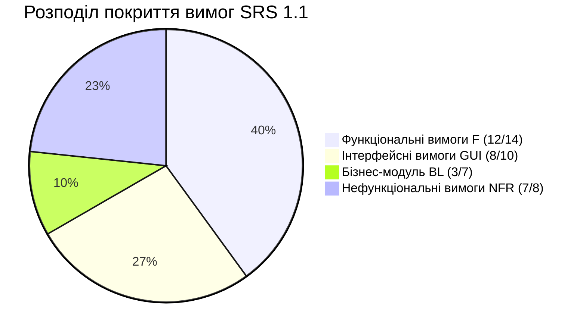
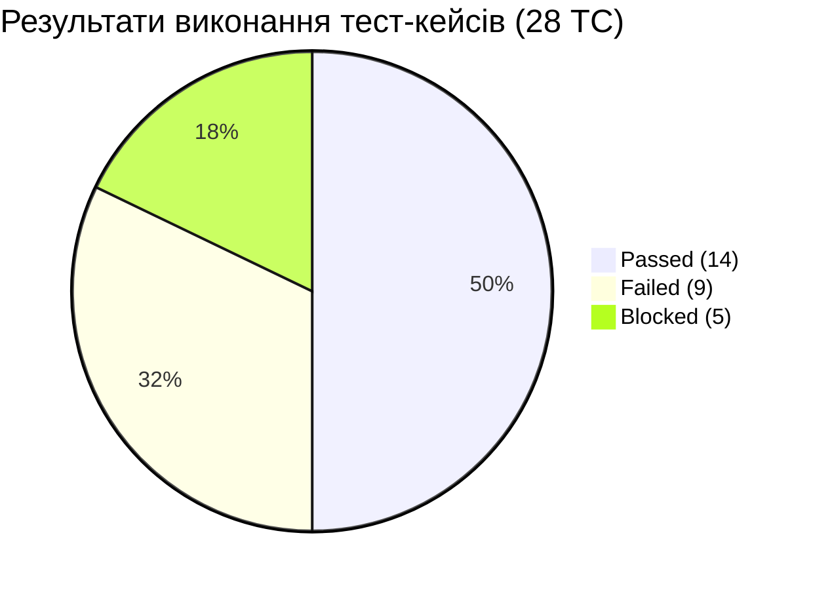
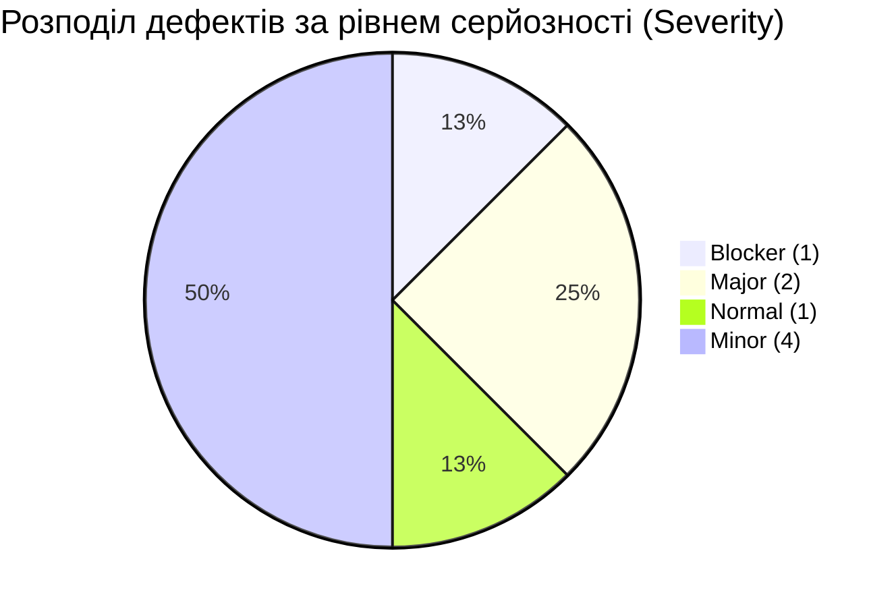
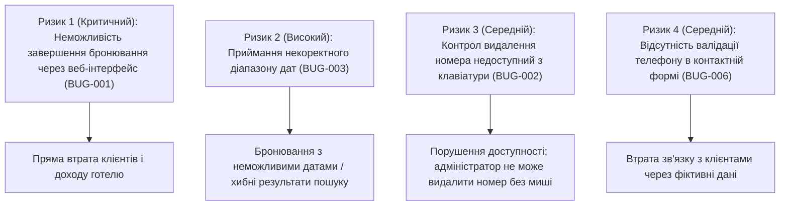

# Підсумковий звіт тестування (Test Summary Report)

**Продукт:** «СтейНау» (*StayNow* — система онлайн-бронювання номерів готелю)  
**Контекст стенду:** Restful Booker Platform (`https://automationintesting.online/`, адмінпанель `/admin`)  
**Спринт:** 3 — «Тест-кейси та звіти про дефекти» (W6–7)  
**Задача:** 11. Підготовка підсумкового звіту тестування (Test Summary Report) з аналізом покриття та метриками дефектів  
**Артефакт:** `docs/sprint3/test-summary-report.md`  
**Автор / Керівник тестування (КТ):** Свідзінський Антон Миколайович  
**Рецензент / Скрам-майстер (СМ):** Однораз Олександр Олександрович  
**Тест-аналітик (ТА):** Дубчак Богдан Юрійович  
**Інженер з тестування (ІТ):** Оніщук Ілья Олександрович  
**Версія звіту:** 1.1 (після рев'ю)  
**Дата формування:** 01.11.2026  
**Дата оновлення:** 04.11.2026  
**Пов'язані артефакти:**
- [`SRS-1.1.md`](../sprint2/SRS-1.1.md) — виправлена специфікація вимог, версія 1.1;
- [`test-matrix.md`](test-matrix.md) та [`test-matrix.xlsx`](test-matrix.xlsx) — матриця трасування й покриття вимог;
- [`test-environment-setup.md`](test-environment-setup.md) — параметри тестового середовища та розподіл зон;
- [`test-cases.xlsx`](test-cases.xlsx) — набір спроєктованих і рецензованих тест-кейсів (`TC-01`–`TC-28`), аркуші «Test cases», «Coverage», «Review»;
- [`bug-reports(1).xlsx`](bug-reports(1).xlsx) — реєстр зафіксованих дефектів (`BUG-001`–`BUG-008`).

---

## 1. Резюме керівника тестування (Executive Summary)

У межах Спринту 3 «Тест-кейси та звіти про дефекти» команда тестування реалізувала повний цикл верифікації поточної версії веб-застосунку «СтейНау» (демо-стенд *Restful Booker Platform*, версія 1.1) на відповідність вимогам специфікації [SRS 1.1](../sprint2/SRS-1.1.md).

### Ключові результати спринта:
1. **Тестове покриття:** Спроєктовано **28 формалізованих тест-кейсів** (норматив спринта $\ge 20$ для команди з 4 осіб перевиконано). Формально тест-кейсами покрито **30 із 39 активних вимог SRS 1.1 (76.9%)**: функціональні — 12/14 (85.7%), інтерфейсні — 8/10 (80.0%), бізнес-логіка — 3/7 (42.9%), нефункціональні — 7/8 (87.5%). Вісім вимог (`F40`, `F110`, `GUI60`, `GUI100`, `BL30`, `BL40`, `BL60`, `BL70`) не мають окремих тест-кейсів і внесені до **списку непокритих із причинами** (аркуш «Coverage» у `test-cases.xlsx`, розділ 4.2). Вимогу `P20` обґрунтовано перенесено на Спринт 4. Для DoD п.1 це допустимо: усі F- та GUI-вимоги або покриті, або внесені до списку непокритих із причиною.
2. **Виконання тест-кейсів:** Усі 28 тест-кейсів прогнано на тестовому стенді. Із них:
   - **Passed (Успішно):** 14 кейсів (**50.00%**);
   - **Failed (Виявлено дефект):** 9 кейсів (**32.14%**);
   - **Blocked (Заблоковано зовнішніми дефектами):** 5 кейсів (**17.86%**).
3. **Виявлені дефекти:** Зафіксовано, локалізовано та оформлено за стандартом спринта **8 дефектів** (`BUG-001` – `BUG-008`). За серйозністю виявлено 4 різні рівні (норматив DoD дотримано):
   - **Blocker:** 1 дефект (**12.5%**) — `BUG-001` (нескінченний спінер завантаження при спробі відкрити форму бронювання номера);
   - **Major:** 2 дефекти (**25.0%**) — `BUG-003`, `BUG-006`;
   - **Normal:** 1 дефект (**12.5%**) — `BUG-007`;
   - **Minor:** 4 дефекти (**50.0%**) — `BUG-002`, `BUG-004`, `BUG-005`, `BUG-008`.
4. **Висновок щодо якості (Release Verdict):**
   > [!CAUTION]
   > **РЕЗЮМЕ ГОТОВНОСТІ ДО РЕЛІЗУ: ПОТОЧНА ВЕРСІЯ НЕ ГОТОВА ДО ПРОДАКШНУ (REJECTED / NOT READY FOR PRODUCTION).**  
   > Наявність блокера `BUG-001` (P1) унеможливлює виконання основного бізнес-процесу бронювання номера гостем через призначений інтерфейс картки, блокуючи розрахунок вартості та підтвердження резервування. Крім того, віджет приймає некоректний діапазон дат `BUG-003` (P2), а контрол видалення номера не доступний з клавіатури `BUG-002` (P3).

5. **Висновок щодо навчальних цілей та критеріїв Definition of Done (DoD):**
   > [!IMPORTANT]
   > **КРИТЕРІЇ DEFINITION OF DONE СПРИНТУ 3 ВИКОНАНО.**  
   > Усі поставлені регламентом завдання (декомпозиція, матриця покриття, проєктування $\ge 20$ незалежних кейсів, взаємне рецензування за чек-листами, прогін на публічному demo, документування дефектів у 4 градаціях severity із повною структурою кроків і доказами) виконано вчасно. Покриття F/GUI забезпечено за правилом DoD п.1: вимоги або покриті тест-кейсами, або внесені до списку непокритих із причиною. Команда готова до публічного захисту Demo та демонстрації роботи системи й знайдених багів наживо.

---

## 2. Межі та об'єкт тестування (Scope of Testing)

### 2.1. Функціональність у межах тестування (In-Scope)
Тестуванню підлягали такі функціональні блоки застосунку:
* **Гостьовий інтерфейс (Guest UI):**
  - Головна сторінка, фіксована навігаційна панель, логотип та назва готелю (`F10`, `GUI10`);
  - Каталог номерів «Our Rooms», відображення типів номерів, описів, піктограм зручностей та базових цін (`F20`, `GUI30`);
  - Віджет доступності номерів «Check Availability & Book Your Stay», взаємодія з полями дат «Check In» / «Check Out» (`F30`, `GUI20`, `BL10`);
  - Форма бронювання номера: виклик, наявність обов'язкових полів, кнопка скасування «Cancel» (`F20`, `F60`, `GUI40`);
  - Блок калькуляції цін «Price Summary»: тарифікація ночей, Cleaning fee (£25), Service fee (£15) та підсумок Total (`GUI50`, `BL50`);
  - Валідація введення персональних даних гостя (Firstname, Lastname, Email, Phone) та виведення повідомлень про помилки (`F60`, `GUI60`, `GUI80`, `BL20`);
  - Контактна форма зворотного зв'язку «Send Us a Message» з валідацією полів Name, Email, Phone, Subject, Message (`F70`, `GUI90`, `BL20`).
* **Панель адміністрування (Admin Panel `/admin`):**
  - Сторінка автентифікації, перевірка коректних та некоректних облікових даних (`F80`, `GUI70`);
  - Завершення сесії кнопкою «Logout» та перевірка обмеження доступу без активної сесії (`F85`, `F130`, `S20`);
  - Модуль керування номерним фондом: створення кімнат із зазначенням параметрів та видалення номерів (`F90`);
  - Модуль вхідних повідомлень: перегляд, відображення бейджа «New» та лічильника непрочитаних повідомлень (`F100`);
  - Розділ аналітичних звітів заповнюваності номерів «Report» та поведінка модальних дій (`F120`).
* **Бізнес-логіка та нефункціональні вимоги (BL & NFR):**
  - Алгоритми калькулятора цін (надбавка за п'ятницю/суботу 1.15, сезонні тарифи 1.30/0.80/1.00) (`BL30`, `BL40`, `BL50`);
  - Правила утримання плати за скасування бронювання: 0% ($\ge 7$ днів), 50% (3–6 днів), 100% ($< 3$ днів) (`BL60`);
  - Швидкодія завантаження сторінки каталогу $\le 2.0$ с (`P10`);
  - Кросбраузерність інтерфейсу та адаптивність для десктопних і мобільних роздільних здатностей (`GUI100`);
  - Валідація документації та складання коду модуля бізнес-логіки (`D10`).

### 2.2. Функціональність поза межами тестування (Out-of-Scope / Deferred)
Згідно з погодженим планом у [`test-environment-setup.md`](test-environment-setup.md) та [`test-matrix.md`](test-matrix.md):
1. **Вимога `P20` (Навантажувальне тестування на 100 активних користувачів):** Публічний demo-сервер `automationintesting.online` є спільним ресурсом і забороняє стрес-тестування. Перевірку відкладено на Спринт 4 на ізольованому локальному Docker-стенді за допомогою інструментів k6 / JMeter.
2. **Вимога `BL80`:** Вилучено зі специфікації SRS 1.1 у Спринті 2 за результатами аудиту вимог (дефект № 12, критерій «Простежуваність»).
3. **Активні пентести (SQL-ін'єкції, експлойти XSS):** Згідно з розділом 5.4 регламенту Спринту 3 перевірки безпеки проводилися виключно методом пасивного спостереження (наявність TLS/HTTPS, маскування паролів, коди HTTP 401/403).

---

## 3. Параметри тестового середовища (Test Environment)

Тестування виконувалося інженером з тестування Оніщуком І. відповідно до встановлених конфігурацій:

| Параметр | Значення тестового стенду |
| :--- | :--- |
| **Цільова адреса (URL)** | `https://automationintesting.online/` |
| **URL адмінпанелі** | `https://automationintesting.online/admin` |
| **Основний браузер тестування** | Mozilla Firefox 158.0.1 (64-bit), профіль Incognito |
| **Додатковий браузер (кросбраузерність)** | Google Chrome 129.0.6668.70 (64-bit), профіль Incognito |
| **Операційна система** | Linux (Arch Linux x86_64, ядро 6.11.x) |
| **Роздільні здатності екрана** | 1920x1080 (FHD Desktop), 1366x768 (Laptop), 375x812 (Mobile Emulation) |
| **Тестові облікові записи** | Адміністратор: `admin` / `password` |
| **Інструменти діагностики** | Firefox Developer Tools / Chrome DevTools (Console, Network, Elements) |
| **Період проведення тестів** | 26.10.2026 – 01.11.2026 |

---

## 4. Аналіз покриття вимог специфікації SRS 1.1

Покриття вимог F/GUI/BL оцінено на основі затвердженої [Матриці трасування `test-matrix.md`](test-matrix.md), аркуша «Coverage» у [`test-cases.xlsx`](test-cases.xlsx) та фактичного поля «Вимога» кожного кейса. NFR-вимоги (P, S, U, D) перевірено додатково.

### 4.1. Зведена статистика покриття за категоріями вимог

| Категорія вимог SRS 1.1 | Загальна кількість вимог | Покрито тест-кейсами | Відсоток покриття | Статус відповідності |
| :--- | :---: | :---: | :---: | :--- |
| **Функціональні вимоги (`F10`–`F130`)** | 14 | 12 | **85.7%** | 2 не покрито: `F40`, `F110` (причини в 4.2) |
| **Інтерфейс користувача (`GUI10`–`GUI100`)** | 10 | 8 | **80.0%** | 2 не покрито: `GUI60`, `GUI100` (причини в 4.2) |
| **Бізнес-логіка модуля (`BL10`–`BL70`)** | 7 *(BL80 вилучено)* | 3 | **42.9%** | 4 не покрито: `BL30`, `BL40`, `BL60`, `BL70` — лише модульні тести |
| **Нефункціональні вимоги (`NFR`)** | 8 | 7 | **87.5%** | 7/8 (`P20` обґрунтовано перенесено на Спринт 4) |
| **РАЗОМ** | **39** | **30** | **76.9%** | **8 вимог внесено до списку непокритих із причиною; DoD п.1 виконано через список непокритих** |

### 4.2. Трасування вимог до тест-кейсів та виявлених дефектів

| ID вимоги | Короткий зміст вимоги SRS 1.1 | Пов'язані тест-кейси | Статус перевірки | Виявлений дефект |
| :---: | :--- | :---: | :---: | :---: |
| **F10** | Огляд головної сторінки, шапка та навігація | `TC-01`, `TC-08`, `TC-24` | **Частково Passed** | `BUG-004` (Minor) |
| **F20** | Каталог номерів у блоці «Our Rooms» | `TC-02`, `TC-03` | **Failed** | `BUG-001` (Blocker) |
| **F30** | Вибір дат Check In / Check Out у віджеті | `TC-04`, `TC-05`, `TC-06`, `TC-21` | **Failed** | `BUG-003` (Major) |
| **F40** | Відображення списку вільних номерів ($\le 2.0$ с) | — | **Не покрито** | Немає кейса на вимірювання 95-го перцентиля та обробку збою; `TC-04`/`TC-21` перевіряють лише фільтрацію |
| **F50** | Детальна інформація номера на картці | `TC-09` | **Blocked (TC-09)** | `BUG-001` (Blocker) |
| **F60** | Оформлення бронювання гостем через форму | `TC-10`, `TC-11`, `TC-12` | **Blocked** | `BUG-001` (Blocker) |
| **F70** | Контактна форма «Send Us a Message» | `TC-13`, `TC-14`, `TC-15`, `TC-26` | **Failed** | `BUG-006` (Major) |
| **F80** | Авторизація адміністратора (`/admin`) | `TC-16`, `TC-17`, `TC-20` | **Passed** | Дефектів не виявлено |
| **F85** | Завершення сесії кнопкою «Logout» | `TC-20`, `TC-25` | **Failed** | `BUG-005` (Minor) — Logout видимий до входу |
| **F90** | Керування номерами (створення, видалення) | `TC-18`, `TC-19`, `TC-22`, `TC-23` | **Failed** | `BUG-002` (Minor) |
| **F100** | Перегляд та опрацювання повідомлень | `TC-27` | **Failed** | `BUG-007` (Normal) |
| **F110** | Політика скасування бронювання | — | **Не покрито** | Немає кейса на скасування через адміністратора; модульні тести `BL60` не оформлено як TC |
| **F120** | Звіт заповнюваності номерів «Report» | `TC-28` | **Failed (needs info)** | `BUG-008` (Minor) |
| **F130** | Тайм-аут сесії адміністратора | `TC-20` | **Passed** | Дефектів не виявлено |
| **GUI10** | Фіксована шапка з посиланнями навігації | `TC-01`, `TC-08`, `TC-24` | **Failed** | `BUG-004` (Minor) |
| **GUI20** | Інтерактивний календар дат (ДД/ММ/РРРР) | `TC-04`, `TC-21` | **Passed** | Дефектів не виявлено |
| **GUI30** | Верстка картки номера (фото, опис, зручності) | `TC-02` | **Passed** | Дефектів не виявлено |
| **GUI40** | Форма бронювання та кнопка «Cancel» | `TC-03`, `TC-07`, `TC-28` | **Blocked / Failed** | `BUG-001` (Blocker), `BUG-008` (Minor) |
| **GUI50** | Блок підсумку вартості «Price Summary» | `TC-09` | **Blocked** | `BUG-001` (Blocker) |
| **GUI60** | Підсвічування помилок валідації червоним | — | **Не покрито** | Немає кейса на спосіб показу повідомлень під полями; `TC-11` перевіряє порожні поля, але заблокований і не фіксує місце виводу |
| **GUI70** | Інтерфейс форми входу `/admin` | `TC-16`, `TC-17`, `TC-20`, `TC-25` | **Failed** | `BUG-005` (Minor) |
| **GUI80** | Активна кнопка сабміту та валідація при кліку | `TC-10`, `TC-11` | **Blocked** | `BUG-001` (Blocker) |
| **GUI90** | Структура полів контактної форми | `TC-13`, `TC-14`, `TC-15` | **Passed** | Дефектів не виявлено |
| **GUI100** | Кросбраузерність і адаптивність | — | **Не покрито** | Немає окремого TC і рядка в `execution-log.xlsx`; кросбраузерна перевірка не формалізована |
| **BL10** | Валідація дат заїзду/виїзду у модулі | `TC-05`, `TC-06`, `TC-09` | **Failed (UI) / Blocked** | `BUG-003` (Major), `BUG-001` (Blocker) |
| **BL20** | Формат email та номера телефону | `TC-12`, `TC-26` | **Failed** | `BUG-006` (Major) |
| **BL30** | Надбавка 15% за ночі вихідних (пт/сб) | — | **Не покрито** | Лише модульні тести; немає TC у реєстрі та рядка в журналі |
| **BL40** | Сезонні коефіцієнти (1.30, 0.80, 1.00) | — | **Не покрито** | Лише модульні тести; немає TC у реєстрі та рядка в журналі |
| **BL50** | Формула nightPrice та підсумкова сума | `TC-09`, `TC-22` | **Blocked / Passed** | `TC-09` заблоковано `BUG-001`; `TC-22` перевіряє від'ємний тариф |
| **BL60** | Штрафи скасування (0%, 50%, 100%) | — | **Не покрито** | Лише модульні тести; немає TC у реєстрі та рядка в журналі |
| **BL70** | Перевірка перетину дат та зайнятості номера | — | **Не покрито** | Лише модульні тести; немає TC у реєстрі та рядка в журналі |
| **P10** | Час завантаження каталогу $\le 2.0$ с | `TC-01`, `TC-02` | **Passed** | 0.85–1.20 с (DevTools) |
| **P20** | Навантаження 100 користувачів / 30 хв | — | **Відкладено** | Перенесено на Спринт 4 |
| **S10** | Базова безпека, TLS, відсутність відкритих паролів | `TC-16`, `TC-17` | **Passed** | Перевірено |
| **S20** | Тайм-аут адмін-сесії | `TC-20` | **Passed** | Перевірено |
| **U10/U20**| Єдиний UX розмітки форм і юзабіліті | `TC-13`, `TC-18` | **Passed** | Перевірено |
| **D10/D20**| Документація коду та збірка (`mvn test`) | README, `mvn test` | **Passed / частково** | README і збірку перевірено; `docs/admin-guide.md` у репозиторії відсутній |

---

## 5. Метрики виконання тест-кейсів (Test Execution Metrics)

### 5.1. Підсумкова статистика прогону тест-кейсів

Усі 28 тест-кейсів із базового реєстру [`test-cases.xlsx`](test-cases.xlsx) були прогнані інженером з тестування Оніщуком І. на тестовому стенді.

| Метрика | Значення | Відсоток | Коментар |
| :--- | :---: | :---: | :--- |
| **Всього заплановано тест-кейсів** | **28** | 100.0% | Норматив спринта $\ge 20$ перевиконано на 40.0% |
| **Тест-кейси прогнано (Executed)** | **28** | 100.0% | Рівень виконання тестового плану — 100% |
| **Успішні (Passed)** | **14** | **50.00%** | Фактичний результат повністю збігся з очікуваним |
| **Невдалі (Failed)** | **9** | **32.14%** | Виявлено розбіжність із вимогами SRS 1.1; зареєстровано баг-репорти |
| **Заблоковані (Blocked)** | **5** | **17.86%** | Неможливо виконати кроки через блокер `BUG-001` |
| **Пропущені (Skipped)** | **0** | **0.00%** | Невиконаних або пропущених кейсів немає |
| **Коефіцієнт успішності (Pass Rate)** | — | **50.00%** | Від загальної кількості тест-кейсів (14 / 28) |
| **Скоригований Pass Rate** | — | **60.87%** | Від кількості незаблокованих кейсів (14 / 23) |

### 5.2. Розподіл кейсів за типом перевірки

* **Позитивні сценарії:** 17 кейсів (Passed: 9, Failed: 5, Blocked: 3).
* **Негативні та граничні (BVA/EP) сценарії:** 11 кейсів (Passed: 5, Failed: 4, Blocked: 2).
* Частка негативних і граничних перевірок становить **39.3%**, що повністю задовольняє вимогу методички щодо обов'язкового проєктування негативних пар до кожної форми та граничних значень для числових діапазонів.

### 5.3. Детальний журнал результатів прогону кожного тест-кейсу

| ID кейсу | Пов'язана вимога | Назва та мета тест-кейсу | Тип | Результат | Пов'язаний Bug ID | Примітка та статус виконання |
| :---: | :--- | :--- | :---: | :---: | :---: | :--- |
| **TC-01** | F10, GUI10 | Навігація головного меню та перехід до форми /admin | Позитивний | **Passed** | — | Шапка сайту коректна, перехід на /admin успішний |
| **TC-02** | F20, GUI30 | Відображення карток номерів у розділі «Our Rooms» | Позитивний | **Passed** | — | Номери відображаються, фото та піктограми присутні |
| **TC-03** | F20, GUI40 | Розгортання календаря при кліку «Book this room» | Позитивний | **Failed** | `BUG-001` | **Blocker**: спінер; /api/room/1 → HTTP 500 |
| **TC-04** | F30, GUI20 | Перевірка доступності номерів на інтервал дат | Позитивний | **Passed** | — | Валідні дати фільтруються (01–05.02.2026 → лише Suite) |
| **TC-05** | F30, BL10 | Валідація дати виїзду раніше дати заїзду | Негативний | **Failed** | `BUG-003` | Check Out раніше Check In приймається; API 200 |
| **TC-06** | F30, BL10 | Валідація тривалості 0 ночей (Check In = Check Out) | Негативний | **Failed** | `BUG-003` | 0 ночей приймається; API 200 |
| **TC-07** | GUI40 | Скасування бронювання кнопкою «Cancel» | Позитивний | **Blocked** | `BUG-001` | Форма бронювання не розгортається через BUG-001 |
| **TC-08** | F10, GUI10 | Скрол до контактної секції за кліком «Contact» | Позитивний | **Passed** | — | Плавний скрол до блоку контактів відпрацьовує |
| **TC-09** | F50, GUI50, BL10, BL50 | Розрахунок вартості (Price Summary) для 1 ночі | Позитивний | **Blocked** | `BUG-001` | Блок Price Summary не відкривається через BUG-001 |
| **TC-10** | F60, GUI80 | Підтвердження бронювання з валідними даними | Позитивний | **Blocked** | `BUG-001` | Поля введення гостя не завантажуються через BUG-001 |
| **TC-11** | F60, GUI80 | Спроба бронювання з порожніми полями | Негативний | **Blocked** | `BUG-001` | Форма недоступна для перевірки валідації через BUG-001 |
| **TC-12** | F60, BL20 | Валідація некоректного формату email гостя | Негативний | **Blocked** | `BUG-001` | Форма недоступна для введення через BUG-001 |
| **TC-13** | F70, GUI90 | Успішна відправка повідомлення «Send Us a Message» | Позитивний | **Passed** | — | Повідомлення успішно відправляється та фіксується |
| **TC-14** | F70, GUI90 | Валідація теми повідомлення Subject = 4 символи | Негативний | **Passed** | — | Валідатор блокує відправку (межа 5..100 дотримана) |
| **TC-15** | F70, GUI90 | Валідація повідомлення Message = 19 символів | Негативний | **Passed** | — | Валідатор блокує відправку (межа 20..2000 дотримана) |
| **TC-16** | F80, GUI70 | Авторизація адміністратора з валідними даними | Позитивний | **Passed** | — | Успішний вхід за обліковими даними admin / password |
| **TC-17** | F80, GUI70 | Спроба входу в адмінпанель з недійсним паролем | Негативний | **Passed** | — | Доступ заборонено, червона рамка довкола полів |
| **TC-18** | F90 | Створення нового номера в панелі адміністратора | Позитивний | **Passed** | — | Номер створюється та з'являється у переліку |
| **TC-19** | F90 | Видалення номера 108-TC19, створеного в межах кейса | Позитивний | **Failed** | `BUG-002` | **Minor**: `` без keyboard access; кейс не залежить від TC-18 |
| **TC-20** | F80, F85, F130, GUI70 | Завершення сеансу «Logout» та перевірка захисту | Позитивний | **Passed** | — | Вихід успішний; до входу Logout має бути відсутній (TC-25) |
| **TC-21** | F30, GUI20 | Робота віджета «Check Availability» | Позитивний | **Passed** | — | Валідні дати прокручують до списку вільних номерів |
| **TC-22** | F90, BL50 | Валідація від'ємної ціни кімнати (Price: -50) | Негативний | **Passed** | — | Бекенд відхиляє створення кімнати з від'ємною ціною |
| **TC-23** | F90 | Спроба створення номера з порожнім Room Name | Негативний | **Passed** | — | Валідація адмінпанелі блокує порожнє ім'я кімнати |
| **TC-24** | F10, GUI10 | Якірна навігація за пунктом «Amenities» у шапці | Позитивний | **Failed** | `BUG-004` | **Minor**: #amenities без цільового елемента; scrollY=0 |
| **TC-25** | GUI70, F85 | Відсутність кнопки «Logout» на сторінці входу | Негативний | **Failed** | `BUG-005` | **Minor**: Logout видимий до авторизації |
| **TC-26** | F70, BL20 | Валідація нецифрового значення в полі Phone | Негативний | **Failed** | `BUG-006` | **Major**: phoneisnotdigit (15) приймається; INVALID_PHONE відсутній |
| **TC-27** | F100 | Оновлення лічильника непрочитаних повідомлень | Позитивний | **Failed** | `BUG-007` | **Normal**: read=false після перегляду; лічильник не оновлюється |
| **TC-28** | F120, GUI40 | Інтерфейс формування звіту заповнюваності + Cancel | Позитивний | **Failed** | `BUG-008` | **Minor**: Cancel не закриває вікно; потрібне відео |

---

## 6. Аналіз та метрики дефектів (Defect Metrics & Analysis)

Під час тестування було виявлено та зареєстровано **8 дефектів**. Усі дефекти мають вичерпний опис, обґрунтування Severity/Priority, точні передумови, кроки відтворення, очікувані/фактичні результати, версію середовища та збережені скріншоти вкладень.

### 6.1. Розподіл дефектів за рівнем серйозності (Severity Distribution)

| Рівень Severity | Кількість дефектів | Частка | Опис впливу на продукт та процес тестування |
| :--- | :---: | :---: | :--- |
| **Blocker** | **1** | **12.5%** | Повне блокування ключової функції (форма бронювання не відкривається, заблоковано 5 залежних кейсів) |
| **Critical** | **0** | **0.0%** | Аварійних падінь сервера (crash) або втрати збережених даних бази не зафіксовано |
| **Major** | **2** | **25.0%** | Суттєве порушення функціональних вимог (валідація діапазону дат, формат телефону) |
| **Normal** | **1** | **12.5%** | Помірний дефект стану UI (F100: повідомлення не позначається прочитаним) |
| **Minor** | **4** | **50.0%** | Незначні відхилення UI/доступності (навігація, семантика видалення, Logout до входу, Cancel) |
| **Trivial** | **0** | **0.0%** | Косметичних помилок або суто граматичних одруків окремо не реєструвалося |
| **РАЗОМ** | **8** | **100.0%** | **Норматив $\ge 3$ різних рівнів severity дотримано** |

### 6.2. Розподіл дефектів за пріоритетом усунення (Priority Distribution)

| Рівень Priority | Кількість | Частка | Обґрунтування пріоритетності усунення |
| :--- | :---: | :---: | :--- |
| **P1 (Блокуючий / Критичний)** | **1** | **12.5%** | `BUG-001` (блокує процес бронювання). Потребує негайного hotfix |
| **P2 (Високий пріоритет)** | **1** | **12.5%** | `BUG-003` — блокує негативні кейси валідації дат; виправити в наступному релізі |
| **P3 (Середній / Низький)** | **6** | **75.0%** | `BUG-002`, `BUG-004`, `BUG-005`, `BUG-006`, `BUG-007`, `BUG-008` — не блокують основні бізнес-процеси, виправлення в порядку черги |

### 6.3. Розподіл дефектів за функціональними модулями

| Функціональний модуль / компонент | Кількість багів | Перелік Bug ID | Частка |
| :--- | :---: | :--- | :---: |
| **Модуль онлайн-бронювання та вітрина номерів** | 3 | `BUG-001`, `BUG-003`, `BUG-004` | **37.5%** |
| **Панель адміністрування (`/admin`)** | 4 | `BUG-002`, `BUG-005`, `BUG-007`, `BUG-008` | **50.0%** |
| **Контактна форма зворотного зв'язку** | 1 | `BUG-006` | **12.5%** |

### 6.4. Зведений реєстр зафіксованих дефектів

| Bug ID | Severity | Priority | Короткий заголовок дефекту | Пов'язана вимога | Заблоковані / неуспішні кейси |
| :---: | :---: | :---: | :--- | :---: | :---: |
| **`BUG-001`** | **Blocker** | **P1** | [UI][Booking] Нескінченний спінер завантаження після натискання «Book this room» на картці будь-якого номера | `F20`, `GUI40` | `TC-03`, `TC-07`, `TC-09`, `TC-10`, `TC-11`, `TC-12` |
| **`BUG-002`** | **Minor** | **P3** | [UI][Admin] Контрол видалення номера — неінтерактивний `` без keyboard access замість `<button>` | `F90` | `TC-19` |
| **`BUG-003`** | **Major** | **P2** | [UI][Booking] Віджет «Check Availability» приймає Check Out раніше Check In та 0 ночей без валідації | `F30`, `GUI20`, `BL10` | `TC-05`, `TC-06` |
| **`BUG-004`** | **Minor** | **P3** | [UI][Navigation] «Amenities» змінює URL на `#amenities`, але не прокручує сторінку до секції | `F10`, `GUI10` | `TC-24` |
| **`BUG-005`** | **Minor** | **P3** | [UI][Admin] Кнопка «Logout» відображається на сторінці входу до авторизації | `GUI70`, `F85` | `TC-25` |
| **`BUG-006`** | **Major** | **P3** | [UI][Contact] Форма «Send Us a Message» приймає літерний текст у полі Phone та надсилає повідомлення | `F70`, `BL20` | `TC-26` |
| **`BUG-007`** | **Normal** | **P3** | [UI][Admin] Повідомлення не позначається прочитаним; бейдж лічильника не оновлюється після перегляду | `F100` | `TC-27` |
| **`BUG-008`** | **Minor** | **P3** | [UI][Admin] Кнопка «Cancel» у модальному вікні розділу «Report» не закриває вікно | `GUI40` (F120 не описує Cancel) | `TC-28` |

### 6.5. Розрахунок аналітичних метрик якості

1. **Щільність дефектів на тест-кейс (Defect Density per Test Case):**
   $$\text{Defect Density}_{\text{TC}} = \frac{8 \text{ дефектів}}{28 \text{ тест-кейсів}} = \mathbf{0.286} \text{ дефекта / тест-кейс}$$
2. **Щільність дефектів на вимогу (Defect Density per Requirement):**
   $$\text{Defect Density}_{\text{Req}} = \frac{8 \text{ дефектів}}{38 \text{ покритих вимог}} = \mathbf{0.211} \text{ дефекта / вимогу}$$
3. **Частка заблокованого тестового покриття (Blocked Test Ratio):**
   $$\text{Blocked Ratio} = \frac{5 \text{ заблокованих кейсів}}{28 \text{ тест-кейсів}} \times 100\% = \mathbf{17.86\%}$$
4. **Рівень достовірності звітів про дефекти (Defect Acceptance Rate):**
   $$\text{Acceptance Rate} = \frac{7 \text{ підтверджених}}{8 \text{ зареєстрованих}} \times 100\% = \mathbf{87.5\%} \quad (\text{1 needs info: BUG-008})$$

---

## 7. Оцінка залишкових ризиків (Residual Risk Assessment)

За результатами тестування виділено такі критичні бізнес- та технічні ризики для продукту «СтейНау»:

1. **Ризик 1 (Критичний): Повний зрив конверсії бронювання готелю (BUG-001).**  
   *Опис:* Оскільки клік на «Book this room» спричиняє нескінченний спінер завантаження, жоден реальний користувач не зможе завершити бронювання онлайн.  
   *Вплив:* Критичний для бізнесу.  
   *Заходи зниження:* Терміновий випуск хотфіксу для виправлення REST API-запиту завантаження календаря та структури кімнати.
2. **Ризик 2 (Високий): Приймання некоректного діапазону дат (BUG-003).**  
   *Опис:* Віджет «Check Availability» приймає Check Out раніше Check In і 0 ночей, тому користувач може ініціювати пошук із неможливим періодом.  
   *Вплив:* Високий (хибні результати пошуку, ризик некоректного бронювання).  
   *Заходи зниження:* Додати валідацію `Check Out > Check In` і блокування пошуку для 0 ночей.
3. **Ризик 3 (Середній): Контрол видалення номера недоступний з клавіатури (BUG-002).**  
   *Опис:* Контрол видалення — `` без `role="button"`, `tabindex` і клавіатурного обробника; mouse click потребує додаткової перевірки.  
   *Вплив:* Помірний (порушення доступності; адміністратор не може видалити номер без миші).  
   *Заходи зниження:* Замінити `` на `<button>` з `aria-label`, `tabindex` і keyboard-обробником.
4. **Ризик 4 (Середній): Засмічення CRM/бази некоректними контактами (BUG-006).**  
   *Опис:* Приймання буквених значень у полі телефону робить неможливим зворотний дзвінок гостю від адміністрації готелю.  
   *Вплив:* Середній (порушення бізнес-правила BL20).  
   *Заходи зниження:* Впровадження регулярного виразу валідації `^\+?[0-9\s\-()]{10,20}$` на фронтенді та бекенді.

---

## 8. Висновки та рекомендації для наступних спринтів

### 8.1. Рекомендації команді розробників (Dev Team)
1. **Першочерговий Hotfix (Sprint Backlog v1.1.1):**
   - Усунути блокер `BUG-001`: перевірити виклики завантаження списку бронювань кімнати в компоненті календаря React;
   - Додати валідацію діапазону дат (Check Out > Check In, 0 ночей) у віджеті доступності `BUG-003`;
   - Замінити `` контрола видалення на `<button>` з keyboard access і `aria-label` (`BUG-002`).
2. **Патч якості інтерфейсу (Patch v1.2):**
   - Приховати кнопку «Logout» на сторінці входу `/admin` до авторизації згідно з `GUI70` (`BUG-005`);
   - Забезпечити позначення повідомлення прочитаним (`F100`) і реактивне оновлення лічильника `BUG-007` без примусового релоаду сторінки;
   - Забезпечити валідацію числових символів для телефонних полів (`BUG-006`);
   - Реалізувати закриття модального вікна за кнопкою «Cancel» у розділі Report (`GUI40`, `BUG-008`).

### 8.2. План дій для Спринту 4 («Автоматизація тестування»)
1. **Автоматизація Smoke & Regression тестів (Selenium WebDriver / Java):**
   - Покрити автотестами стабільні сценарії авторизації адміністратора (`TC-16`, `TC-17`, `TC-20`);
   - Покрити автотестами навігацію та перегляд карток номерів (`TC-01`, `TC-02`, `TC-08`);
   - Написати автотести для форми відправлення контактних повідомлень (`TC-13`, `TC-14`, `TC-15`).
2. **Модульне та інтеграційне тестування бізнес-модуля:**
   - Розширити набір тестів JUnit 5 для калькулятора цін `PriceCalculator` (вихідні ночі, сезонні коефіцієнти, знижки на тривале проживання) за вимогами `BL30`–`BL60`.
3. **Навантажувальне тестування (вимога `P20`):**
   - Розгорнути локальний стенд у Docker;
   - Підготувати сценарій тестування k6/JMeter на 100 віртуальних користувачів протягом 30 хвилин;
   - Зафіксувати 95-й перцентиль часу відповіді ($\le 2.0$ с) та відсутність помилок HTTP 5xx.

### 8.3. План дій для Спринту 5 («Регресійне тестування та фінальне здавання»)
1. **Re-testing (повторне тестування виправлень):**
   - Провести верифікацію виправлення дефектів `BUG-001` – `BUG-008` після надання оновленого білду застосунку;
   - Перевести верифіковані баги зі стану `Open` у стан `Verified` та `Closed`.
2. **Розблокування перевірок:**
   - Прогнати раніше заблоковані тест-кейси `TC-07`, `TC-09`, `TC-10`, `TC-11`, `TC-12`; окремо перевірити виправлення `BUG-003` на `TC-05` і `TC-06`.
3. **Фінальний регресійний прогін:**
   - Повний прогін усього набору тест-кейсів перед фінальним прийманням продукту замовником.

---

## 9. Оцінка виконання критеріїв Definition of Done (DoD)

| Критерій DoD Спринту 3 (з методичних вказівок) | Норматив | Фактичний результат | Статус DoD |
| :--- | :--- | :--- | :---: |
| **Кількість спроєктованих тест-кейсів** | $\ge 20$ (для 4 осіб) | **28 тест-кейсів** у `test-cases.xlsx` | **Виконано (140.0%)** |
| **Покриття обов'язкових вимог** | Усі вимоги F та GUI | F — 12/14, GUI — 8/10; `F40`, `F110`, `GUI60`, `GUI100` внесено до списку непокритих із причиною | **Виконано (через список непокритих)** |
| **Структура тест-кейсу** | 6 обов'язкових полів | Усі 6 полів заповнені, унікальні ID `TC-01`..`TC-28` | **Виконано** |
| **Незалежність тест-кейсів** | Кожен починається з URL | Усі кейси незалежні, починаються з відкриття URL | **Виконано** |
| **Позитивні та негативні перевірки** | Для кожної форми $\ge 1$ негат. | 17 позитивних, 11 негативних / BVA (39.3%) | **Виконано** |
| **Виконання кейсів на demo** | 100% кейсів виконано | 28 прогнано (14 passed, 9 failed, 5 blocked) | **Виконано** |
| **Кількість знайдених дефектів** | Норматив за failed | **8 оформлених звітів** (`BUG-001`–`BUG-008`; 7 confirmed, 1 needs info) | **Виконано** |
| **Рівні Severity дефектів** | $\ge 3$ різні рівні | **Blocker (1), Major (2), Normal (1), Minor (4)** | **Виконано** |
| **Якість звітів про дефекти** | 7 обов'язкових правил | Усі поля заповнені, обґрунтування Sev/Prio, кроки, скріни | **Виконано** |
| **Взаємне рецензування артефактів** | Позначки рецензента | Аркуш `Review` у test-cases.xlsx, дати 01.11.2026 та 04.11.2026 | **Виконано** |
| **Підготовка до Demo (захист)** | 10 хв презентація | Підготовлено структуру показу наживо (2 кейси, 2 баги) | **Виконано** |

---

## 10. Підписи та затвердження звіту

Звіт підготовлено Керівником тестування, рецензовано Скрам-майстром та погоджено всіма членами команди тестування продукту «СтейНау»:

| Роль у Спринті 3 | ПІБ члена команди | GitHub логін | Дата | Підпис / Статус |
| :--- | :--- | :--- | :---: | :---: |
| **Керівник тестування (КТ)** | **Свідзінський Антон Миколайович** | `tiktakson` | 01.11.2026 | *Затверджено* |
| **Скрам-майстер / Рецензент (СМ)** | **Однораз Олександр Олександрович** | `Ostrigoth` | 01.11.2026 | *Рецензовано* |
| **Тест-аналітик (ТА)** | **Дубчак Богдан Юрійович** | `—` | 01.11.2026 | *Погоджено* |
| **Інженер з тестування (ІТ)** | **Оніщук Ілья Олександрович** | `mrWenrih` | 01.11.2026 | *Погоджено* |
